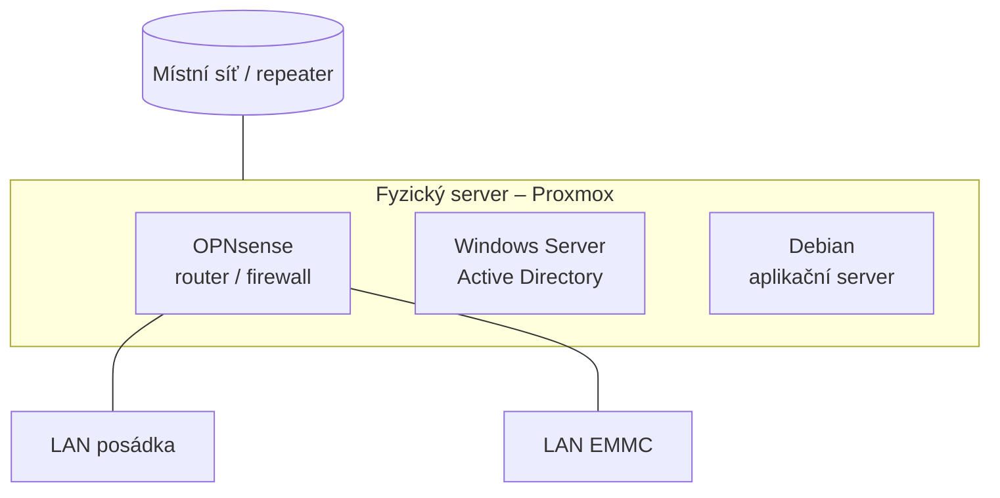

# Infrastruktura

Přehled toho, co v síti běží. Podrobnosti jsou na podstránkách.

| Stroj | Role | Adresa | Stránka |
|---|---|---|---|
| Proxmox | hypervisor | TODO | [Proxmox](proxmox.md) |
| OPNsense | router, firewall, DHCP? | TODO | [OPNsense](opnsense.md) |
| Windows Server | Active Directory, DNS? | TODO | [AD](ad-server.md) |
| Debian | aplikace | TODO | [Debian](debian-app.md) |
